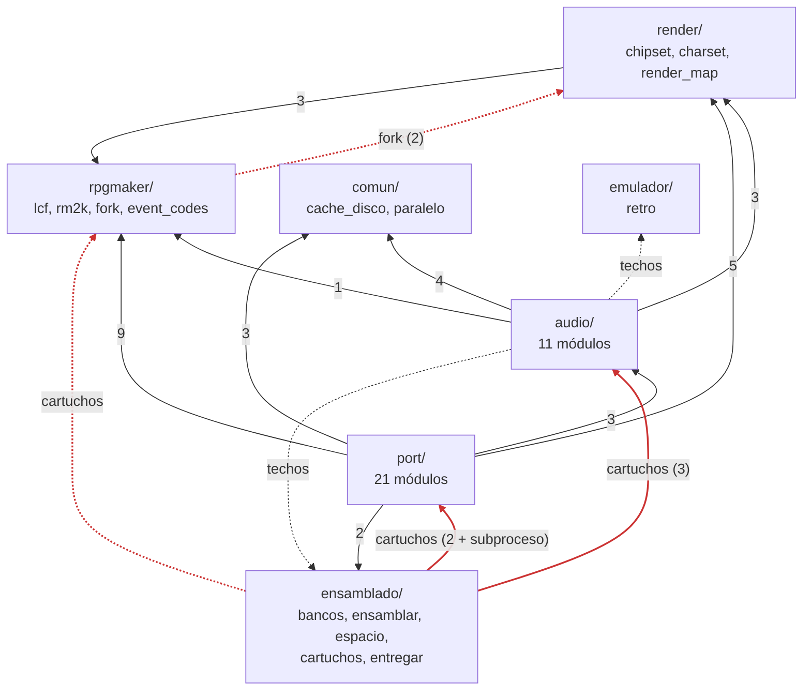
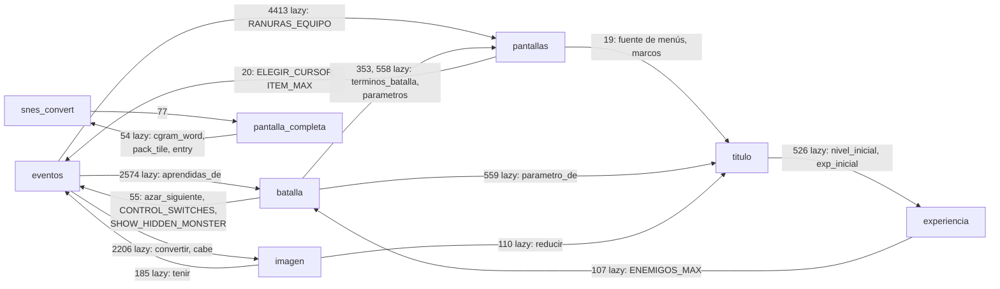

# El mapa de las herramientas de Python

> **Foto del 2026-09-28, sobre el commit `e314ff7b`.** Los números son de ese
> día y este archivo no se actualiza. El grafo salió de un script de AST que se
> tiró; el apéndice D lo trae entero, así que se puede volver a correr sobre
> cualquier commit. Lo demás salió de leer los archivos, y cada afirmación dice
> qué se leyó o qué se buscó. Ninguna prueba cubre este documento.

Lo pidió taro: entender el grafo de dependencias de los `.py` de `tools/`, qué
responsabilidad tiene cada uno y qué es agnóstico a ABL. Y, con eso, un plan
por partes para llegar a dos repos: por un lado las herramientas y el motor,
que no saben de ningún juego; por el otro, A Blurred Line.


## Resumen

**Casi todo el Python de `tools/` ya es agnóstico en lo que hace.** Lo único
del juego que está escrito en el código son dos bloques de contenido y unas
veinte perillas sueltas:

* los dos bloques son la lista de cartuchos de `ensamblado/cartuchos.py` y las
  tablas de efectos y temas de `audio/snes_music.py`;
* las perillas son IDs de mapa, nombres de asset y defaults. Están en
  `snes_convert`, `eventos`, `escena`, `rm2k`, `render_map`, `snes_samples`,
  `msu`, `msu_datos` y `entregar`, y cada una se puede sacar sola (§3).

En `rom/src/` el código no nombra ningún ID de ABL. Lo marcan tres constantes
de identidad —el título de la cabecera, la firma de la SRAM y la del `.msu`— y
un puñado de supuestos del tipo "ningún actor del ABL tiene golpe crítico".

**Lo que ata el repo a ABL no es saber del juego, sino la forma del árbol.**
Once módulos calculan la raíz del repo desde `__file__` y leen de ahí `data/`,
`parches/`, `rom/src/`, `rom/build/` y `pruebas/casos/`. Las rutas del juego
original, del RTP y del SoundFont salen de variables `ABL_*` cuyo default es
una ruta de esta máquina. La frontera entre los dos repos es justamente eso:
**cuál es la raíz del proyecto y qué hay adentro**.

**Lo que no se puede separar todavía son las pruebas.** Los 114 archivos de
prueba (`ls pruebas/*/test_*.py | wc -l`) corren sobre material de ABL, incluidas las de `rpgmaker/`, que
prueban el motor. Sólo una se salva: `herramientas/test_indice.py`. Hasta que
exista el "juego golden" de la wishlist, el motor no tiene con qué probarse
fuera de ABL.

**El grafo está mejor de lo que dice `tools/README.md`, pero no como lo dice.**

* Los ciclos no son tres. En `port/` hay una sola componente fuerte de seis
  módulos: `eventos`, `batalla`, `pantallas`, `imagen`, `titulo` y
  `experiencia`.
* Además hay dos ciclos que el README no nombra: `snes_convert`↔
  `pantalla_completa` y, en la capa de más abajo, `lcf`↔`fork`.
* Las violaciones de capa salen de dos archivos nada más:
  * `ensamblado/cartuchos.py` importa de `port/` y de `audio/`, y corre
    `snes_convert.py` como subproceso;
  * `rpgmaker/fork.py` importa de `render/`.
* Todos los ciclos se rompen **moviendo** funciones o constantes, sin cambiar
  lógica (§4, paso 1).

### La recomendación

Seis pasos, cada uno verificable por separado, y **ninguno pide esperar al
juego golden**. El orden va de lo mecánico a lo de criterio:

1. **Desenredar el grafo moviendo cosas.** Es mecánico y se verifica con las
   ROMs byte por byte iguales. Es lo que más destraba y lo que menos cuesta.
2. **Un solo lugar que sepa dónde está el proyecto.** Los once cálculos de la
   raíz pasan a una función, y los `ABL_*` pasan a ser flags que el repo de ABL
   completa. También es mecánico.
3. **Las perillas de ABL a un archivo de proyecto** en TOML. Una perilla por
   commit, con los mismos valores, así que la ROM tampoco cambia.
4. **Partir `cartuchos.py`** en el mecanismo y la lista de ABL.
5. **Dos raíces en el mismo repo.** El motor por un lado y ABL por el otro,
   con una prueba que impida que el motor nombre rutas del juego. Es un
   monorepo con la frontera ya verificada.
6. **El corte en dos repos**, con `git filter-repo`: con la frontera ya cuidada
   por una prueba, es mecánico.

Cuánto de esto se hace antes de tener el juego golden es la primera de las
preguntas para taro (§5).

**Cómo se cruza con Rust.** El paso 3 es la condición para que cada
herramienta pueda ser un binario: una herramienta con entradas explícitas y
sin raíz implícita ya tiene la forma de un CLI. Por eso **el archivo de
proyecto tiene que ser datos (TOML) y no un módulo de Python**: un
`import abl_config` lo podría leer sólo Python. Separar en dos repos y pasar a
Rust son ejes distintos. Este corte facilita el otro siempre que la frontera
sea de datos.


## 1. El grafo

### Cómo se midió

El script del apéndice D recorre el AST de cada `.py` de `tools/*/` y de
`pruebas/`. Clasifica cada import en tres clases:

* **`import`**: un import a nivel de módulo;
* **`lazy`**: un import adentro de una función, de una clase o del
  `if __name__`. Son los que hoy esconden los ciclos: Python no los ve al
  cargar;
* **`ruta`**: un literal de texto que *es* la ruta de otro `.py`, como el
  subproceso de `cartuchos`.

La primera versión contaba como `ruta` cualquier texto que *nombrara* un `.py`,
docstrings y `help=` incluidos, y daba una sola componente de treinta módulos:
ruido. Con el literal entero como ruta quedan dos aristas reales:

* `cartuchos` corre `snes_convert.py` como subproceso
  (`cartuchos.py:408-409`);
* `snes_convert` mete en la clave de su caché el hash de `rm2k`, `render_map`,
  `chipset` y `asignador` (`snes_convert.py:1805-1809`).

Las capas son las de `tools/README.md`. `rpgmaker`, `comun`, `ensamblado` y
`emulador` son una misma fila; arriba de ellas va `render`, después `audio` y
arriba de todo `port`. Una violación es importar de la misma fila o de una más
alta.

### Por paquete

Las flechas son imports entre archivos de paquetes distintos, `import` y
`lazy` juntos; entre paréntesis, cuántas aristas. En rojo, las que violan las
capas.



Leído en limpio:

* **`comun/`, `emulador/` y `ensamblado/{bancos,ensamblar,entregar}` son
  hojas**: no importan nada de `tools/`.
* **`render/` depende sólo de `rpgmaker/`**, y es la única flecha que baja
  limpia.
* **`audio/` importa `render/` sólo por `GAME_DIR`, `RTP_DIR` y
  `find_resource`**, que no son de dibujo (`snes_music.py:25`, 117, 135 y 437;
  `msu.py:76`). Son la configuración del juego y la búsqueda de recursos de
  RM2k, y viven en `render_map.py:26-39` por historia.
* **`cartuchos.py` está en la capa equivocada.** Es el que orquesta todo, pero
  vive abajo.
  * De `port/` y de `audio/` usa sólo `tiles_bin.binario()`,
    `comprimir.binario()` y `muestras_brr.binario()`, que son `shutil.which`
    para la huella (`cartuchos.py:270-271`).
  * Usa también `snes_music.leer_techos()`, para meter `techos.toml` en la
    huella (257-258), y `msu.armar()`, para las pistas (475).
  * Y de `rpgmaker/` usa `lcf.TreeMap`, para la regla de qué mapas van (145).

### Adentro de `port/`: la componente fuerte



El script lo imprime así, con `import` y `lazy` juntos:

    SCC: rpgmaker.fork, rpgmaker.lcf
    SCC: port.batalla, port.eventos, port.experiencia, port.imagen,
         port.pantallas, port.titulo
    SCC: port.pantalla_completa, port.snes_convert

Con sólo los imports a nivel de módulo **no hay ningún ciclo**. Todos los
cierra un import perezoso, que es lo que se usó para esquivarlos.

Lo que dice `tools/README.md` de los ciclos se comprobó así:

* **`eventos`↔`batalla`**: sigue siendo cierto.
* **`batalla`↔`pantallas`**: no es directo. `pantallas` no importa `batalla`,
  y el ciclo cierra pasando por `eventos`.
* **`eventos`↔`imagen`**: sigue siendo cierto.
* **Los helpers de paleta de `titulo`**: es cierto, y es más que la paleta.
  `titulo.py` tiene al menos tres módulos adentro, y ninguno es de la pantalla
  de título:
  * `reducir` y `convertir`, que son cualquier imagen a N colores y cualquier
    imagen de pantalla completa a 8 bpp. Los usan `escena`, `animacion`,
    `imagen` y `pantalla_completa`;
  * los menús y las ranuras;
  * la fuente y los marcos de los menús. Los usan `pantallas`,
    `fin_del_juego` y `snes_convert`.

  Del título de verdad sólo son `opciones`, `menu` y `COLORES`
  (`snes_convert.py:7830-7841`).

### Quién usa cada módulo desde afuera

La tabla completa, con líneas, entradas y salidas, está en el apéndice A. Los
que deciden qué arrastra cada corte son éstos:

| módulo | pruebas que lo importan | justfile |
|---|--:|---|
| `port/eventos` | 27 | |
| `render/render_map` | 22 (21 por `GAME_DIR`) | |
| `ensamblado/cartuchos` | 18 | `cartuchos`, `build`, `espacio` |
| `rpgmaker/lcf` | 13 | |
| `port/snes_convert` | 12 (casi todas en `herramientas/`) | vía `cartuchos` |
| `port/titulo` | 9 | |
| `port/batalla`, `rpgmaker/rm2k`, `audio/snes_music` | 7 cada uno | |

Las recetas del `justfile` que corren un `.py` por su ruta son `cartuchos`,
`build`, `espacio`, `entregar`, `parches`, `parches-check` y `techos`. Además,
`protocolo` escribe `port/event_opcodes.py` y `audio/music_opcodes.py`.


## 2. Qué hace cada archivo

Clase: **A** es agnóstico. **A+g** es agnóstico con un gancho de ABL que se
puede sacar a configuración; el gancho va en §3. **ABL** es del juego. El
criterio es si necesita saber algo de *este* juego para funcionar.

| archivo | líneas | qué hace | clase |
|---|--:|---|---|
| `rpgmaker/event_codes` | 20 | carga `event_codes.json` (de liblcf): número de comando ↔ nombre | A |
| `rpgmaker/lcf` | 940 | lee el volcado de Ditto en `data/`: `Map`, `Database`, `TreeMap` | A+g |
| `rpgmaker/rm2k` | 475 | las reglas de RM2k: pasabilidad, capas, poses, gráfico de una página, translúcidos | A+g |
| `rpgmaker/fork` | 584 | valida y aplica `parches/manual/`: forks de mapa, mapas nuevos, ChipSets por receta | A+g |
| `comun/cache_disco` | 89 | caché en disco con el hash de fuentes y binarios en la clave | A+g |
| `comun/paralelo` | 63 | `en_paralelo`: lo puro en procesos bifurcados | A |
| `ensamblado/bancos` | 423 | reparte lo generado en bancos y escribe el `.cfg` de `ld65` | A (motor) |
| `ensamblado/ensamblar` | 227 | `ca65` + `ld65`, checksum, símbolos; se niega si hay `.inc` en `rom/src/` | A (motor) |
| `ensamblado/espacio` | 160 | cuánto le queda a cada cartucho, leído del `.dbg` y del `.cfg` | A (motor) |
| `ensamblado/cartuchos` | 482 | qué cartuchos hay, con qué flags y casos; los arma y decide si están viejos | **mezcla**: mecanismo A, contenido ABL |
| `ensamblado/entregar` | 227 | copia `release` a la carpeta compartida para taro | flujo de trabajo; va con ABL |
| `emulador/retro` | 441 | un core de libretro desde Python, cuadro a cuadro | A |
| `render/chipset` | 339 | un ChipSet a un atlas con los autotiles resueltos | A |
| `render/charset` | 19 | medidas de un CharSet | A |
| `render/render_map` | 396 | las capas de un mapa como imágenes; **y** `GAME_DIR`, `RTP_DIR`, `find_resource` | A+g |
| `audio/midi` | 230 | lector mínimo de MIDI | A |
| `audio/musica` | 49 | del MIDI a notas y voces, sin chip | A |
| `audio/sdsp` | 267 | el S-DSP: registros, envolventes, volumen | A |
| `audio/spc700` | 145 | ensamblador mínimo de SPC700 para el driver | A |
| `audio/music_opcodes` | 335 | generado por `protocol` desde `music.toml` | A (motor) |
| `audio/muestras_brr` | 306 | puente a Gunter, con caché | A |
| `audio/snes_samples` | 345 | el banco de muestras desde el SoundFont | A+g |
| `audio/efectos_msu` | 105 | a qué tasa va cada efecto de calidad en el `.msu` | A |
| `audio/snes_music` | 2629 | MIDI → BRR + stream del S-DSP; el paquete de audio por mapa | A+g, con un tramo ABL (269-417) |
| `audio/msu` | 354 | las pistas PCM de MSU-1 con fluidsynth | A+g |
| `audio/techos` | 308 | mide el pico de cada tema en la ROM y escribe `techos.toml` | A+g (lo que escribe es de ABL) |
| `port/event_opcodes` | 194 | generado por `protocol` desde `events.toml` | A (motor) |
| `port/comprimir` | 117 | puente al binario `lz2` | A |
| `port/tiles_bin` | 123 | puente a Voodoo | A |
| `port/asignador` | 217 | qué colores se pierden y cómo se agrupan en paletas | A |
| `port/experiencia` | 109 | curva de experiencia y subida de nivel (easyrpg) | A |
| `port/batalla` | 1185 | el modelo de la pelea: fórmulas, IA, páginas de tropa, turnos | A (simplifica lo que ABL no usa) |
| `port/imagen` | 204 | el cartel de `ShowPicture` en objetos | A |
| `port/pantalla_completa` | 68 | una imagen de pantalla completa en un flujo LZ2 | A |
| `port/animacion` | 350 | una animación de batalla en una caja de OAM | A (caja medida en ABL) |
| `port/escena` | 567 | fondo y battlers de la pelea compuestos en la consola | A+g |
| `port/msu_datos` | 160 | el formato del `.msu` de datos: firma, índice, fondos | A+g |
| `port/fin_del_juego` | 205 | `Scene_End` del menú de pausa | A+g |
| `port/fuente` | 239 | las fuentes 6x12 de easyrpg, generadas, sólo ASCII | A+g |
| `port/ventana` | 193 | la ventana de mensaje armada desde el System | A+g |
| `port/textos` | 371 | reparte los `ShowMessage` al ancho de la SNES | A+g |
| `port/pantallas` | 925 | equipo, tienda y la grilla de texto de la pelea | A+g |
| `port/titulo` | 1713 | el título, **y** los menús, las ranuras, la fuente de menús y la reducción de color | A+g |
| `port/parches` | 747 | escribe y verifica las decisiones con pérdida como TOML | A+g (lo versionado es de ABL) |
| `port/eventos` | 5515 | compila páginas de evento a bytecode | A+g |
| `port/snes_convert` | 9544 | el conversor: de un juego a `mapdata.inc`, `musicdata.inc` y el `.msu` | A+g |

### `snes_convert.py` por secciones

**Ninguna sección es de ABL.** Las funciones (`grep -c '^def '`) son 132 ese
día. Conviene distinguir dos clases de agnóstico:

* **herramienta RM2k**: lee el juego y decide colores, tiles y paletas. Se
  podría extraer tal cual;
* **motor**: emite lo que `rom/src/` espera, así que se mueve junto con el
  ensamblador aunque no sepa nada del juego.

| líneas | sección | funciones principales | clase |
|---|---|---|---|
| 1-91 | imports; le cambia a `lcf` `DECORAR_TRANSLUCIDO` y `REAJUSTAR_TEXTOS` | — | A (el docstring nombra ABL) |
| 92-406 | fondo en modo 3: CGRAM, cuantización, tiles de 8 y 4 bpp, capa de encima | `bg_budget` 145, `pack_tile` 265, `cgram_word` 297, `convert_above` 367, `entry` 396 | RM2k |
| 407-758 | sprites de personaje: colores, poses, paleta, peso para el reparto | `sprite_colors` 442, `paleta_del_personaje` 512, `peso_de_grafico` 664 | RM2k, gancho `PESO_DE_GRAFICO` 653 |
| 759-1252 | eventos opacos horneados en la capa alta; NPCs dibujables | `eventos_horneables` 799, `hornear_en_el_mapa` 959, `npcs_dibujables` 973 | RM2k |
| 1253-1742 | banco de sprites y extras de OAM: poses, cronómetro, lluvia, cartel, animación | `build_characters` 1253, `banco_de_poses` 1339, `npc_table` 1703 | RM2k |
| 1743-2132 | las capas del mapa, con caché y en paralelo | `capas_convertidas` 1815, `_convert_layers` 1913, `convert` 2028 | RM2k |
| 2133-2616 | la ventana de tilemap de 64x32 y los repartos de VRAM | `vram_layout` 2424, `_controlar_repartos` 2550 | motor |
| 2617-2817 | ventana de mensajes y fuente | `convert_ventana` 2638, `fuente_bytes` 2746 | RM2k |
| 2818-3088 | bloques de 16x16 con pasabilidad y terreno; `TileSubstitution` | `build_blocks` 2818, `Sustituciones` 2882 | RM2k |
| 3089-3564 | el registro por mapa y las animaciones en `.inc` | `tabla_de_mapas` 3255, `animaciones_asm` 3470 | motor |
| 3565-3644 | curvas de experiencia | `experiencia_asm` 3578 | motor |
| 3645-4051 | qué fondos y battlers lleva el cartucho | `escena_de_la_rom` 3649, `escenas_asm` 3901 | motor, usa `escena.REEMPLAZO` |
| 4052-4583 | emisión de bajo nivel, material compartido, LZ2, encuentros | `tabla_de_paginas` 4083, `Materiales` 4225, `comprimir_los_bloques` 4372 | motor |
| 4584-6780 | **`emit()`**: el `mapdata.inc` entero, en una función de ~2200 líneas | ver abajo | motor |
| 6781-7187 | tablas de NPC y eventos, orden de mapas, firma de la partida | `orden_de_mapas` 6899, `firma_de_la_partida` 6989, `actor_table_asm` 7160 | motor, `ANIMA_QUIETO_MAX` 6912 medido en ABL |
| 7188-7286 | la línea de comandos | `parser_de_flags` 7188 | defaults de ABL |
| 7287-8288 | `main()`: orquesta todo | — | A salvo los defaults |
| 8289-8432 | el `.msu`: fondos y efectos de calidad | `escribir_msu` 8289 | motor |
| 8433-8580 | qué temas llegan sonando a cada paquete | `temas_heredados` 8447, `temas_de_la_rom` 8534 | motor, gancho `SALTOS_QUE_NO_SE_DAN` 8444 |
| 8581-8888 | análisis del juego: arranque, líderes, ítems, miembros | `lideres_posibles` 8624, `items_posibles` 8760 | RM2k, global `args_game_dir` 8757 |
| 8889-9008 | los casos de prueba (`--caso`) | `partir_en_casos` 8892, `pagina_de_caso` 8983 | A (usa los IDs reservados de `eventos`) |
| 9009-9541 | `convertir()`: un mapa entero | `convertir` 9009 | RM2k |

`emit()` por tramos:

| líneas | qué emite |
|---|---|
| 4603-5075 | constantes de cabecera |
| 5076-5186 | tablas de mapas y poses |
| 5187-5230 | ventana, fuente y mensajes |
| 5231-5340 | cartel, título y `pantallas_tabla` |
| 5340-5910 | ranuras, ítems, tienda, fin, y las tablas del banco 0 |
| 5914-6190 | menú y equipo |
| 6190-6470 | habilidades, experiencia, partida, comunes y tropas |
| 6470-6575 | encuentros y enemigos |
| 6575-6780 | constantes de batalla y esperas |

Quién usa `snes_convert` desde afuera:

* `cartuchos`, como subproceso;
* `pantalla_completa`, que importa `cgram_word`, `pack_tile` y `entry`: es el
  ciclo;
* diez pruebas de `herramientas/`, `rpgmaker/test_animacion_cuadros.py`
  (`cuadro_de_animacion`) y `abl/test_msu_datos.py` (`fondo_bytes`,
  `pack_tile`).

Para `todo/las-responsabilidades-de-snes-convert.md`, lo más barato es sacar
tres cosas a módulos propios:

* **el formato de la SNES** (92-406 y `entry`): rompe el ciclo con
  `pantalla_completa`;
* **los repartos de VRAM** (2133-2616): ya los prueba solo `test_repartos`;
* **`emit()`**, partido por los tramos de la tabla de arriba.

### `eventos.py` por secciones

**Ninguna sección es de ABL.** Los mapas y personajes de ABL aparecen en unas
cuarenta líneas de comentario. Por rangos:

* **1-1308: la base.** Comandos, paneo, escapes, rutas de movimiento, temas,
  gráficos, fundidos y triggers.
* **1309-1482: el bloque de textos** (`Mensajes`).
* **1483-2283: el índice de lo que el juego usa.** Variables, ítems, lluvia,
  animaciones, `base_de_datos` con su caché (2091) y la imagen única
  (`Imagenes` 2166).
* **2284-2927: el índice del juego entero.** Variables, comunes, actores,
  términos, habilidades y elecciones.
* **2928-3509: tropas y encuentros al azar.**
* **3510-5113: el compilador.** Tiene `compilar_pagina` (3630) y `_compilar`
  (4317).
* **5114-5515: lo que queda.** Estado del grupo, recorridos, IDs reservados
  (5202-5227), tinte y saturación (5228-5314), `paginas_del_mapa` (5335) y
  `ruta_propia` (5457).

Los ganchos van en §3. Lo que ata a `eventos` al resto de `port/` es poco, y
está en §4.


## 3. Qué es de ABL

### Los ganchos del Python, en cuatro clases

**a) Datos del juego escritos en el código.** Van al archivo de proyecto.

| dónde | qué |
|---|---|
| `ensamblado/cartuchos.py:40-208` | todo el contenido: `MENOR_A = 105`, `EXCLUIDOS` (16 mapas con su razón), `AGREGADOS`, `MAPA_DE_DEBUG = 900`, `CON_MAPA_DE_DEBUG`, `MAPAS_DE_PRUEBA`, `GRAFICOS`, `--grupo 10 --map-id 4` de `release`, el cartucho `test-special` entero, `FUERA`, y los nombres de caso `nada` y `mapa-de-debug` (222-223) |
| `audio/snes_music.py:269-417` | `SE_ENTEROS`, `SE_ENTEROS_PAGADOS`, `SE_DEL_MAPA`, `SE_DE_RUTA_SIN_PAQUETE`, `SE_DE_TROPA_AL_PAQUETE` y `TEMAS_APARTE`: tablas por oído, por mapa y por nombre de efecto. Las leen también `eventos.py:4292-4313` y `snes_convert.py:8106` |
| `audio/snes_music.py:882` | `SE_DE_SIEMPRE = 92`, medido sobre el `release` de ABL |
| `audio/snes_music.py:1997` | la ruta de `parches/auto/musica/techos.toml` |
| `port/snes_convert.py:653` | `PESO_DE_GRAFICO = {"savept": 2, "Future1": 1}` |
| `port/snes_convert.py:8444` | `SALTOS_QUE_NO_SE_DAN = {45: {20}}` |
| `port/escena.py:198` | `REEMPLAZO = "ABLBackdropSJ08"`, el fondo de reemplazo |
| `rpgmaker/rm2k.py:284` | `SIN_TRAMA = frozenset({"savept"})` |
| `port/snes_convert.py:7193` | `--map-id` con default `7` |

**b) La identidad y el ambiente.** Van a flags o al archivo de proyecto.

| dónde | qué |
|---|---|
| `render/render_map.py:26`, `:36` | `GAME_DIR` y `RTP_DIR`, de `ABL_GAME_DIR` y `ABL_RTP_DIR`, con default a una ruta de esta máquina. Los leen `snes_music`, `msu`, `snes_convert`, `escena` y 21 pruebas; el `justfile` y `abl/test_hover_tram.py` repiten el default |
| `port/snes_convert.py:7194-7196`, `:8757` | `--game-dir` y `-o` con default de este repo; el global `args_game_dir` |
| `audio/snes_samples.py:48-50` | `ABL_SOUNDFONT`, con default a un `.sf2` elegido para ABL (el sintetizador con que se compuso) |
| `audio/msu.py:90` | `REEMPLAZOS`, una ruta fija de esta máquina con los reemplazos de pista de ABL |
| `comun/cache_disco.py:38` | `ABL_CACHE`: sólo el nombre |
| `rpgmaker/lcf.py:41-42`, `rpgmaker/fork.py:59-67` y 5 lugares más de `fork.py` | `data/` y `parches/manual/` como rutas fijas bajo la raíz |
| `ensamblado/cartuchos.py:337`, `audio/techos.py:147`, `:269`, `ensamblado/entregar.py` (varios) | el nombre `abl.sfc` / `abl.msu` / `abl-*.pcm`, repetido a mano |
| `port/msu_datos.py:78` | `MAGIA = b"ABLD"`, la firma del `.msu` de datos, que la ROM compara |
| once módulos | la raíz del repo, calculada desde `__file__`: `cache_disco`, `entregar`, `techos`, `cartuchos`, `espacio`, `ensamblar`, `render_map`, `fork`, `lcf`, dos veces `snes_music` (`TECHOS`, `RAM_LEJANA`) y `parches.py:659` |

**c) Límites del motor medidos sobre ABL.** No son datos del juego: son
supuestos del motor que otro juego podría romper. **No van al archivo de
proyecto.** Se quedan en el motor, y la pregunta es si fallan fuerte cuando no
alcanzan (§5).

* **Constantes dimensionadas para ABL**:
  * `eventos.py:1653` `ITEMS_N = 451`, los ítems del LDB de ABL, que se podría
    sacar de `len(db.items)`;
  * `:1434` `MENSAJES_PASO = 4`;
  * `:1639` `VAR_RANURA_MAX`;
  * `:2773` `SWITCH_MAX`.
* **Valores medidos sobre ABL, que se podrían leer del LDB**:
  * `eventos.py:1071` `FUNDIDO_CUADROS = 35`, que supone la transición 0/0;
  * `:3262` `ENC_RATE = 100`, más la suposición de que ninguna tropa filtra
    por terreno.
* **Los IDs reservados**: `eventos.py:5202` `SWITCH_DE_PRUEBA = 1023`, `:5215`
  `VARIABLE_DE_CASO = 1000` y `:5222` `SWITCH_IMPOSIBLE = 1021`. Son números
  libres *en ABL*, y los usan también `cartuchos`, el arnés y `rm2k.py:301`.
* **Anchos y medidas**:
  * `ventana.py:49` `COLUMNAS = 39`, medido sobre las líneas de ABL;
  * los anchos de `pantallas.py` (104, 106, 687, 703-709, 750, 821);
  * los de `titulo.py` (763, 1444);
  * `MENU_X`/`MENU_Y` del título (205-209), puestos sobre el arte de ABL;
  * `snes_convert.py:6912` `ANIMA_QUIETO_MAX`;
  * la caja de 64 de `animacion.py:53`.
* **Texto y fuente**:
  * sólo ASCII (`eventos.py:1452-1455`, `fuente.py`);
  * `cp1252` en `fin_del_juego.py:59`;
  * `MINCHO` por omisión (`fuente.py:226`, `ventana.py:164`);
  * `es_hablante` de `textos.py:95-109`, la convención de ABL de poner en
    mayúsculas el nombre del que habla;
  * `VACIA = "- Empty -"` en `titulo.py:336`.
* **Simplificaciones de `batalla.py`**: no lee el `hit` del arma (548-553),
  ignora `first_strike` (822-825), y las páginas por variable dan
  `NotImplementedError` (651).
* **El volumen**: `sdsp.py:219-222`, `AIRE` y los techos, ajustados sobre los
  temas de ABL.

**d) Prosa.** Los comentarios y docstrings nombran mapas, personajes y temas
de ABL en todos los archivos grandes. Algunos, además, **se emiten al `.inc`**
(`snes_convert.py:3270-3276`, 4662-4673). No cambian nada de lo que hace el
código.

### Lo que no es Python

| qué | de quién | lo que se leyó o se buscó |
|---|---|---|
| `rom/src/` (93 `.s`) | **motor**, salvo tres constantes | Un grep de nombres y números de ABL fuera de comentarios no da nada; todo lo del juego entra por `mapdata.inc` y `musicdata.inc`, que genera el conversor. Las constantes son `cabecera.s:12` `"A BLURRED LINE"`, `partida.s:45` la firma `"ABLS"` de la SRAM (copiada en `pruebas/arnes/consola.py:62`) y, del lado del conversor, la `"ABLD"` del `.msu`. Los supuestos son del tipo de la clase c: sin golpe crítico (`batalla.s:397`), cuatro ranuras (`partida.s:24`), la transición de pelea fija (`fundido_de_pelea.s`) |
| `rom/src/*_opcodes.inc` | motor | generados por `protocol` |
| `parches/` | **mecanismo del motor, contenido de ABL** | `auto/` (mapas, animaciones, battlers, `techos.toml`) sale de correr el conversor sobre ABL; `manual/` (6 forks, 3 ChipSets por receta, el mapa 900 de debug) es rediseño a mano de ABL. El formato y las reglas viven en `fork.py`, `parches.py` y los dos README, que mezclan las reglas con "qué hay forkeado hoy" |
| `data/` | ABL | es el juego, volcado. `data/README.md` describe el formato de Ditto: podría ir con Ditto |
| `pruebas/casos/` (242 JSON) | ABL | 237 empiezan con un `Teleport` a un mapa de ABL; los otros usan tropas de ABL |
| `pruebas/golden/` | ABL | capturas del arte de ABL y del RTP: no se pueden publicar |
| `pruebas/rpgmaker/` | **motor por intención, ABL por material** | los 67 archivos usan mapas, temas o datos de ABL |
| `pruebas/herramientas/` | casi todo ABL por material | 20 de 21 usan `GAME_DIR`, `data/` o un cartucho; la agnóstica es `test_indice.py` |
| `pruebas/abl/` | ABL | — |
| `pruebas/arnes/` | **mezcla** | agnósticos: `dibujo`, `menu`, `lz2`. Genéricos con restos de ABL: `consola` (la firma `ABLS`, las opciones "Begin the Story"), `tanda` y `datos`. De ABL: `recorrido`, `piedras`, `batalla` y `video` |
| `justfile` | mezcla | del motor: `protocolo*`, `gunter-`, `voodoo-` y `lz2-pruebas`, `herramientas`, `cartuchos`, `build` y `espacio`. De ABL: `datos`, `ditto-*` (por el corpus por omisión), `pruebas-abl`, `parches*`, `techos`, `entregar` y `video` |
| `workflow/` | mezcla | `decisiones/` y `divergencias/` son del motor, aunque midan con mapas de ABL. `tasks/` es mayormente ABL |
| `docs/` | motor | `rpgmaker/`, `snes/`, `port/` y `research/`, con ejemplos de ABL |
| `README.md`, `AGENTS.md` | los dos | el README mezcla el juego con la arquitectura; `AGENTS.md` es casi todo reglas de trabajo, salvo "Dónde corre esto" |
| `DITTO.md` | el repo que use `data/` como fuente de verdad | él mismo dice que se queda si Ditto se muda |

Sobre licencias:

* no hay ningún archivo de licencia en el repo (`find -iname '*licen*'`);
* el juego y el RTP ya viven afuera, a propósito, detrás de `ABL_GAME_DIR` y
  `ABL_RTP_DIR`;
* pero `data/` (31 MB) y `pruebas/golden/` (5,5 MB) son material derivado de
  ABL y del RTP, y están versionados. **Ninguno de los dos puede ir en un repo
  público del motor, ni en su historia.**


## 4. El plan

La regla es la de AGENTS.md: **primero lo mecánico, solo en su commit y
verificado; después lo de criterio.** En este repo, verificado quiere decir
tres cosas:

* `just cartuchos` da todas las ROMs byte por byte iguales a las de antes;
* `just pruebas` está en verde;
* el script del apéndice D muestra lo que el paso prometía.

Todos los pasos 1 a 3 dejan las ROMs idénticas, porque no cambian ningún
valor.

### Paso 1: desenredar el grafo moviendo cosas (mecánico)

Cada ítem va en su commit. El orden es por lo que destraba:

1. **`GAME_DIR`, `RTP_DIR` y `find_resource` salen de `render_map` a
   `rpgmaker/`**, por ejemplo a un `rpgmaker/recursos.py`. Con eso `audio/` deja
   de importar `render/`, y los once lectores de la raíz tienen dónde
   converger en el paso 2.
2. **La geometría de ChipSet y CharSet** (`caja_de_terreno`, `caja_de_comun`,
   `TILE`, `SPRITE_*`) **baja a `rpgmaker/rm2k.py`**, que ya duplica `POSE_W` y
   `POSE_H`. `fork.py` deja de importar `render/`.
3. **`lcf`↔`fork`.** Hay dos maneras de romperlo:
   * `fork` recibe el `Map` en vez de importarlo;
   * o la parte de imagen de `fork` (`podar`, `_pose`, `imagen_del_chipset`,
     `imagenes`) sube a `render/`, y `fork` queda como validación de JSON.

   La segunda es la que deja a `rpgmaker/` sin PIL.
4. **`cartuchos` deja de importar `port/` y `audio/`.**
   * Los tres `binario()` son `shutil.which` de un nombre: una lista alcanza.
   * `leer_techos` es leer un TOML.
   * `pistas()` se orquesta desde la receta.

   La alternativa es declarar que `cartuchos` es la capa de arriba de todo, y
   eso es lo honesto: es el que orquesta. Eso pide mudarlo, y es una pregunta
   de §5.
5. **La componente fuerte de `port/`**, con siete movidas sin lógica nueva:
   * `batalla.aprendidas_de` → `eventos`, o a un módulo de reglas de RM2k;
   * `pantallas.RANURAS_EQUIPO` y `batalla.ENEMIGOS_MAX` → un módulo de
     constantes;
   * `eventos.tenir` y sus ayudas (5228-5314) → un `port/color.py`;
   * `titulo.reducir` y `titulo.convertir` → un `port/paleta.py`;
   * `ventana.LINEAS` y `ventana.COLUMNAS` → constantes. Así importar `eventos`
     deja de cargar PIL y `render_map`;
   * `titulo.parametro_de` y `nivel_de`, y `pantallas.terminos_batalla` y
     `parametros` → reglas de RM2k.

   Hecho eso, `eventos` queda como hoja del lado del motor.
6. **`pack_tile`, `cgram_word` y `entry` salen de `snes_convert`** a un módulo
   del formato de la SNES. Rompe el ciclo con `pantalla_completa`, y es el
   primer corte de `las-responsabilidades-de-snes-convert`.
7. **`titulo.py` se parte en título, menús y ranuras, y fuente de menús.** Es
   mover, pero es mucho mover: conviene dejarlo después de los otros seis.

Al terminar, el script tiene que imprimir **ninguna componente fuerte y
ninguna violación**, y `tools/README.md` se reescribe con el grafo de verdad.

### Paso 2: un solo lugar que sabe dónde está el proyecto (mecánico)

Un módulo nuevo, `comun/proyecto.py`, con una función `raiz()` que hoy
devuelve lo mismo que devuelven los once cálculos. Esos once pasan a usarla,
y también las rutas derivadas de ella:

* `data/`, `parches/manual/`, `parches/auto/`;
* `rom/src/`, `rom/build/`, `pruebas/casos/`.

Y los defaults de ambiente —el juego, el RTP, el SoundFont, los reemplazos de
MSU-1— se leen en **un** lugar.

Todavía no cambia la interfaz: es juntar lo disperso, así el paso 3 toca un
archivo y no once. Se verifica igual que el paso 1.

### Paso 3: las perillas de ABL a un archivo de proyecto (criterio)

Un archivo de datos en la raíz del proyecto —en TOML, porque Rust ya lo lee
(`protocol`)— con lo de las clases a y b de §3:

```toml
# boceto, no una propuesta cerrada
[rom]
nombre = "abl"                    # abl.sfc, abl.msu, abl-N.pcm
titulo = "A BLURRED LINE"         # la cabecera, 21 caracteres
firma_sram = "ABLS"               # cambiarla invalida las partidas de taro
firma_msu = "ABLD"

[juego]
mapa_inicial = 4
grupo = [10]

[graficos]
peso = { savept = 2, Future1 = 1 }
sin_trama = ["savept"]
fondo_de_reemplazo = "ABLBackdropSJ08"

[audio]
# las tablas de snes_music.py:269-417, SE_DE_SIEMPRE y los saltos que no se dan

[cartuchos]
# lo de cartuchos.py:40-208
```

Va **una perilla por commit**, con el mismo valor, y la ROM tiene que salir
idéntica. La firma de la SRAM y el título tienen un detalle: salen del
conversor a un `.inc`, así que tocan `rom/src/`. Es el único lugar del paso
donde cambia el ensamblador, y cambia sin cambiar bytes.

Las rutas del ambiente **no** van en el archivo, porque no son del proyecto
sino de la máquina. Los `.py` dejan de leer las `ABL_*` y reciben
`--game-dir`, `--rtp-dir` y `--soundfont`. El `justfile` del repo de ABL es el
que traduce `$ABL_GAME_DIR` a un flag.

Así cada herramienta queda con **entradas explícitas**: la raíz del proyecto,
los flags del ambiente, y nada implícito. Eso es lo que la hace sustituible por
un binario.

### Paso 4: partir `cartuchos.py` (criterio)

El mecanismo se queda del lado del motor: `huella`, `sello`, `viejo`, `armar`,
`convertir`, `manifiesto` y `main` (242-482).

Lo que es de ABL se va al archivo de proyecto: la regla de qué mapas van, las
exclusiones con sus razones, los cartuchos y sus casos. Las razones de
`EXCLUIDOS` son prosa que hoy vive en comentarios, y en TOML siguen siendo
comentarios.

El `900` del mapa de debug tiene que salir de `fork.nuevos()` y no escribirse
dos veces.

### Paso 5: dos raíces en el mismo repo (mecánico, con una red nueva)

Antes de partir el repo, hay que partir el árbol:

* `motor/`, con `rom/src/`, `tools/` sin `entregar`, `docs/rpgmaker|snes|port`,
  `workflow/decisiones` y `workflow/divergencias`;
* `abl/`, con `data/`, `parches/`, `pruebas/`, el archivo de proyecto, el
  `justfile` de ABL y `entregar`.

Los nombres son a decidir. Con eso, una prueba nueva cobra la frontera:
**ningún archivo de `motor/` nombra una ruta de `abl/`, ni una variable
`ABL_*`**. Es la misma clase de red que `test_protocolo`, que cobra que
`rom/src/` no declare opcodes a mano.

Mover es gratis en ROM pero no en `blame`: los porqués de este repo viven en el
`git log`. Por eso este paso lleva las mismas precauciones que el corte de
`main.s`, `-C` e histogram, y se comprueba en una muestra antes de darlo por
hecho.

### Paso 6: el corte (mecánico)

Con `git filter-repo`, dos veces, una por raíz. La historia del motor **no
puede** llevar `data/` ni `pruebas/golden/` (§3, licencias), así que el filtro
es por ruta, y las rutas cambiaron dos veces:

* la mudanza a `tools/*/` del 2026-09-19;
* el corte de `main.s` del 2026-09-25.

Hay que filtrar con todos los nombres históricos, y comprobar después, con un
`git log --all -- data/` vacío en el repo del motor, que no quedó nada.

### Qué pasa con las pruebas y las goldens

**Hasta que haya juego golden, las pruebas viven con ABL**, porque todas usan
su material. Así, el repo del motor sale con las pruebas de los proyectos de
Rust, `test_indice` y poco más.

Lo que sí se puede ir preparando sin el juego golden:

* **Partir el arnés.** `consola`, `tanda`, `dibujo`, `menu`, `lz2` y `datos`
  van al motor, sin la firma `ABLS` fija —sale del archivo de proyecto— y sin
  las opciones del título de ABL. `recorrido`, `piedras`, `batalla` y `video`
  se quedan con ABL.
* **`pruebas/casos/`** es el embrión del juego golden, como dice la wishlist:
  el formato de caso es del motor, los 242 casos son de ABL. Cuando exista el
  juego golden, cada caso de `rpgmaker/` se reescribe contra uno de sus mapas.
  Así es como una prueba se muda de repo.
* **Las goldens van con su juego.** Las de ABL se quedan con ABL. El juego
  golden trae las suyas, que sí se pueden publicar si sus assets se pueden
  publicar: ése es el bloqueo de licencias de la wishlist.

### Cómo se cruza con Rust

* Los pasos 2 y 3 son los que acercan a Rust: una herramienta que recibe todo
  explícito tiene ya la forma de un binario.
* **Lo que trabaría es que la frontera fuera Python.** Si el archivo de
  proyecto es un módulo, cada binario futuro tendría que embeber un intérprete
  o duplicarlo; si es TOML, lo lee cualquiera.
* Los candidatos obvios a binario, cuando llegue el momento, son hojas que ya
  son agnósticas y tienen entradas y salidas claras:
  * `render/`: un mapa a imágenes;
  * `asignador`;
  * la cadena de audio sin sus tablas: de `midi` a `snes_music`.
* `snes_convert` es el último, y sólo después de partido.
* Nada del plan pide esperar a Rust, ni al revés.


## 5. Preguntas para taro

1. **¿Se separa antes o después del juego golden?**
   * a) Hacer ahora los pasos 1 a 5, y cortar (paso 6) recién con el juego
     golden empezado.
   * b) Cortar ya: el motor sale sin pruebas de ROM propias, y las corre el
     repo de ABL.
   * c) Esperar al juego golden para todo.

   **Recomiendo a).** Los pasos 1 a 5 valen solos, porque ordenan el grafo y
   hacen explícita la frontera. Y cortar con el motor sin pruebas deja el repo
   que se quiere publicar sin red.

2. **¿Cómo consume ABL al motor?**
   * a) Submódulo de git, fijado por commit.
   * b) Instalado desde el PATH, como los proyectos de Rust.
   * c) Por un tiempo, un monorepo con dos raíces (el paso 5).

   **Recomiendo c) primero y a) después.** Las goldens de ABL son capturas de
   *una* versión del motor, así que ABL necesita fijar la versión, y un
   submódulo fija por commit. "Desde el PATH" funciona para herramientas
   estables, pero el motor cambia con cada feature del juego.

3. **¿Un repo o dos del lado agnóstico?**
   * a) Uno solo: herramientas de RM2k, conversor y `rom/src/` juntos.
   * b) Dos: las herramientas de RM2k que no saben de la SNES (`rpgmaker/`,
     `render/`, Ditto) por un lado; el motor de SNES (`port/`, `audio/`,
     `ensamblado/`, `rom/src/`) por el otro.

   **Recomiendo a) por ahora.** El contrato entre el conversor y el
   ensamblador son los `.inc` generados, y separarlos pide versionar ese
   contrato. `protocol` ya lo hace para los opcodes, pero no para
   `mapdata.inc`.

4. **¿En qué idioma queda el repo del motor?** La regla de AGENTS.md dice que
   lo que no sabe nada del juego va en inglés, y el motor pasaría a ser eso:
   treinta y dos mil líneas de Python y 93 archivos de ensamblador, en
   castellano.
   * a) Excepción: el motor sigue en castellano.
   * b) Traducirlo antes de publicarlo.
   * c) Traducir cada parte cuando se reescriba, por ejemplo al pasar a Rust.

   **Recomiendo c).** Traducir todo es un cambio sin red que verifique la
   prosa, y el paso a Rust la reescribe igual.

5. **Los límites del motor medidos sobre ABL (clase c de §3), ¿se derivan de
   los datos o se dejan?**
   * a) Dejarlos, y que el conversor falle fuerte cuando otro juego no entra.
     Muchos ya lo hacen: `ITEMS_N` lo cobra `test_items.py`, y
     `_controlar_repartos` corta si no entra.
   * b) Derivar los que se pueden: `ITEMS_N` de `len(db.items)`, el fundido de
     las transiciones del LDB, `ENC_RATE` del terreno.

   **Recomiendo a) hoy y b) caso por caso cuando el juego golden lo pida.**
   Cada uno es una feature, no un refactor.

6. **¿Dónde vive `cartuchos.py`?**
   * a) Arriba de todo, en una capa propia de orquestación.
   * b) En `ensamblado/`, sin los imports hacia arriba (paso 1.4).

   **Recomiendo a).** Es lo que ya es.

7. **¿Se conserva la historia en los dos repos?** `git filter-repo` la
   conserva, pero con dos riesgos: los renombres de rutas y que se cuele
   `data/`. Empezar de cero pierde el registro, que en este repo *es* el
   `git log`. **Recomiendo conservarla**, con la comprobación del paso 6.

8. **`workflow/`**: ¿`decisiones/` y `divergencias/` van con el motor?
   **Recomiendo que sí**, reescribiendo los ejemplos de ABL cuando se toquen y
   no antes. `tasks/` se queda con ABL, y el motor arranca uno vacío.

9. **Los comentarios que nombran a ABL en el motor** (clase d), ¿se limpian
   para publicar? **Recomiendo que no**: son los porqués, y ABL es el juego
   con el que se midió cada cosa. Lo que sí conviene limpiar es lo que se
   **emite** al `.inc` y los `help=` de la línea de comandos.

### Lo que no sé

* **Si el paso 1.5 deja las ROMs idénticas lo dice la corrida, no la
  lectura.** Mover funciones no debería cambiar bytes, pero `cache_disco` mete
  en la clave el hash de los fuentes. Si `snes_convert.py:1805-1809` lista
  archivos que se mueven, hay que actualizar esa lista en el mismo commit, o
  el caché queda mintiendo. Verificar con `SIN_CACHE=1`, como pide AGENTS.md.
* **No revisé las dependencias internas** de `pantallas.parametros` ni de
  `terminos_batalla` (paso 1.5): puede que arrastren más de lo que parece.
* **No medí cuánto de `pruebas/rpgmaker/` se podría reescribir** contra un
  juego golden chico. Es la estimación que decide cuándo conviene cortar.
* **Las licencias de los SoundFonts y de la fuente del sistema** siguen como
  las dejó la wishlist: sin mirar.


## Apéndice A: por módulo

Salida de `tabla()` del script (apéndice D). "Importa" y "lo importan" cuentan
módulos distintos de `tools/` (`import` + `lazy`); "pruebas" cuenta archivos
de `pruebas/`; "justfile" es si una línea que no es comentario nombra su
ruta.

| módulo | líneas | importa (tools) | lo importan (tools) | lo importan (pruebas) | justfile |
|---|--:|--:|--:|--:|---|
| `rpgmaker/event_codes` | 20 | 0 | 2 | 0 |  |
| `rpgmaker/fork` | 584 | 3 | 3 | 1 |  |
| `rpgmaker/lcf` | 940 | 2 | 10 | 13 |  |
| `rpgmaker/rm2k` | 475 | 1 | 3 | 7 |  |
| `comun/cache_disco` | 89 | 0 | 4 | 0 |  |
| `comun/paralelo` | 63 | 0 | 3 | 0 |  |
| `ensamblado/bancos` | 423 | 0 | 2 | 3 |  |
| `ensamblado/cartuchos` | 482 | 7 | 3 | 18 | sí |
| `ensamblado/ensamblar` | 227 | 0 | 2 | 3 | sí |
| `ensamblado/entregar` | 227 | 0 | 0 | 0 | sí |
| `ensamblado/espacio` | 160 | 3 | 0 | 1 | sí |
| `emulador/retro` | 441 | 0 | 1 | 4 |  |
| `render/charset` | 19 | 1 | 2 | 0 |  |
| `render/chipset` | 339 | 0 | 3 | 1 |  |
| `render/render_map` | 396 | 5 | 7 | 22 |  |
| `audio/efectos_msu` | 105 | 3 | 1 | 0 |  |
| `audio/midi` | 230 | 0 | 1 | 1 |  |
| `audio/msu` | 354 | 4 | 1 | 0 |  |
| `audio/muestras_brr` | 306 | 1 | 4 | 1 |  |
| `audio/music_opcodes` | 335 | 0 | 1 | 2 | sí |
| `audio/musica` | 49 | 0 | 1 | 0 |  |
| `audio/sdsp` | 267 | 0 | 2 | 2 |  |
| `audio/snes_music` | 2629 | 10 | 6 | 7 |  |
| `audio/snes_samples` | 345 | 2 | 3 | 0 |  |
| `audio/spc700` | 145 | 0 | 1 | 0 |  |
| `audio/techos` | 308 | 4 | 0 | 1 | sí |
| `port/animacion` | 350 | 3 | 1 | 2 |  |
| `port/asignador` | 217 | 0 | 3 | 0 |  |
| `port/batalla` | 1185 | 4 | 3 | 7 |  |
| `port/comprimir` | 117 | 0 | 3 | 1 |  |
| `port/escena` | 567 | 3 | 1 | 2 |  |
| `port/event_opcodes` | 194 | 0 | 1 | 1 | sí |
| `port/eventos` | 5515 | 10 | 6 | 27 |  |
| `port/experiencia` | 109 | 1 | 2 | 3 |  |
| `port/fin_del_juego` | 205 | 3 | 1 | 1 |  |
| `port/fuente` | 239 | 0 | 4 | 0 |  |
| `port/imagen` | 204 | 2 | 2 | 0 |  |
| `port/msu_datos` | 160 | 0 | 1 | 2 |  |
| `port/pantalla_completa` | 68 | 3 | 1 | 0 |  |
| `port/pantallas` | 925 | 4 | 3 | 4 |  |
| `port/parches` | 747 | 1 | 1 | 1 | sí |
| `port/snes_convert` | 9544 | 27 | 1 | 12 |  |
| `port/textos` | 371 | 2 | 1 | 1 |  |
| `port/tiles_bin` | 123 | 0 | 2 | 0 |  |
| `port/titulo` | 1713 | 6 | 8 | 9 |  |
| `port/ventana` | 193 | 2 | 6 | 4 |  |

## Apéndice B: el grafo por archivo

Salida de la sección "ARISTAS POR ARCHIVO". Sin marca es `import`; `[lazy]` es
un import adentro de una función; `[ruta]` es un literal con la ruta del
archivo.

    rpgmaker.event_codes ->
    rpgmaker.fork        -> rpgmaker.lcf[lazy], render.chipset[lazy], render.charset[lazy]
    rpgmaker.lcf         -> rpgmaker.fork, rpgmaker.event_codes
    rpgmaker.rm2k        -> rpgmaker.lcf
    comun.cache_disco    ->
    comun.paralelo       ->
    ensamblado.bancos    ->
    ensamblado.cartuchos -> audio.muestras_brr, ensamblado.ensamblar, port.tiles_bin,
                            port.comprimir, rpgmaker.lcf[lazy], audio.snes_music[lazy],
                            audio.msu[lazy], port.snes_convert[ruta]
    ensamblado.ensamblar ->
    ensamblado.entregar  ->
    ensamblado.espacio   -> ensamblado.bancos, ensamblado.ensamblar, ensamblado.cartuchos[lazy]
    emulador.retro       ->
    render.charset       -> render.chipset
    render.chipset       ->
    render.render_map    -> render.charset, rpgmaker.fork, rpgmaker.lcf, rpgmaker.rm2k,
                            render.chipset
    audio.efectos_msu    -> audio.muestras_brr, audio.snes_music, audio.snes_samples
    audio.midi           ->
    audio.msu            -> audio.snes_music, audio.snes_samples, comun.cache_disco,
                            render.render_map
    audio.muestras_brr   -> comun.cache_disco
    audio.music_opcodes  ->
    audio.musica         ->
    audio.sdsp           ->
    audio.snes_music     -> rpgmaker.lcf, audio.musica, audio.midi, audio.muestras_brr,
                            audio.sdsp, audio.snes_samples, audio.spc700, comun.paralelo,
                            render.render_map[import/lazy], audio.music_opcodes
    audio.snes_samples   -> audio.muestras_brr, comun.cache_disco
    audio.spc700         ->
    audio.techos         -> audio.sdsp, audio.snes_music, emulador.retro[lazy],
                            ensamblado.cartuchos[lazy]
    port.animacion       -> render.render_map[lazy], port.eventos[lazy], port.titulo[lazy]
    port.asignador       ->
    port.batalla         -> port.eventos, rpgmaker.lcf[lazy], port.pantallas[lazy],
                            port.titulo[lazy]
    port.comprimir       ->
    port.escena          -> render.render_map[lazy], port.titulo[lazy], port.asignador[lazy]
    port.event_opcodes   ->
    port.eventos         -> rpgmaker.rm2k, port.event_opcodes, port.ventana[lazy],
                            rpgmaker.fork[lazy], rpgmaker.lcf[lazy], port.imagen[lazy],
                            comun.paralelo[lazy], port.batalla[lazy],
                            audio.snes_music[lazy], port.pantallas[lazy]
    port.experiencia     -> port.batalla[lazy]
    port.fin_del_juego   -> port.titulo, port.ventana, port.fuente[lazy]
    port.fuente          ->
    port.imagen          -> port.titulo[lazy], port.eventos[lazy]
    port.msu_datos       ->
    port.pantalla_completa -> port.comprimir, port.titulo, port.snes_convert[lazy]
    port.pantallas       -> port.titulo[import/lazy], port.eventos, port.ventana[lazy],
                            rpgmaker.lcf[lazy]
    port.parches         -> ensamblado.cartuchos[lazy]
    port.snes_convert    -> ensamblado.bancos, port.tiles_bin, port.comprimir,
                            rpgmaker.event_codes, port.eventos, rpgmaker.lcf,
                            rpgmaker.rm2k[import/ruta], port.textos, port.animacion,
                            port.imagen, port.asignador[import/ruta], port.parches,
                            port.titulo, port.pantalla_completa, port.fin_del_juego,
                            port.pantallas, port.batalla, port.experiencia, port.escena,
                            port.msu_datos, audio.efectos_msu, comun.paralelo,
                            audio.snes_music, render.render_map[import/ruta],
                            comun.cache_disco[lazy], port.ventana[lazy],
                            port.fuente[lazy], render.chipset[ruta]
    port.textos          -> port.eventos, port.ventana
    port.tiles_bin       ->
    port.titulo          -> port.asignador, port.fuente, port.ventana[lazy],
                            port.experiencia[lazy], render.render_map[lazy],
                            rpgmaker.lcf[lazy]
    port.ventana         -> render.render_map, port.fuente[lazy]

## Apéndice C: las violaciones de capa, una por línea

    rpgmaker.fork:351        -> render.chipset      [lazy]
    rpgmaker.fork:427        -> render.charset      [lazy]
    rpgmaker.fork:447        -> render.charset      [lazy]
    rpgmaker.fork:448        -> render.chipset      [lazy]
    ensamblado.cartuchos:28  -> audio.muestras_brr  [import]
    ensamblado.cartuchos:30  -> port.tiles_bin      [import]
    ensamblado.cartuchos:31  -> port.comprimir      [import]
    ensamblado.cartuchos:145 -> rpgmaker.lcf        [lazy]   (misma fila)
    ensamblado.cartuchos:257 -> audio.snes_music    [lazy]
    ensamblado.cartuchos:475 -> audio.msu           [lazy]
    ensamblado.cartuchos:409 -> port.snes_convert   [ruta]   (subproceso)

## Apéndice D: el script

Se corre con `python3 grafo.py <raíz del repo>` y no necesita nada fuera de la
biblioteca estándar. La foto se sacó con Python 3.14. Imprime las secciones que
citan los apéndices A a C y los ciclos, en tres variantes: sólo `import`,
`import` + `lazy`, y las tres clases juntas.

```python
#!/usr/bin/env python3
"""Grafo de imports de tools/ (AST), más quién lo usa desde pruebas/ y justfile.

Aristas:
  import : import a nivel de módulo
  lazy   : import adentro de una función, clase o del `if __name__`
  ruta   : un literal de texto que ES la ruta de otro .py de tools/
"""
import ast, collections, os, re, sys

RAIZ = os.path.abspath(sys.argv[1])
TOOLS = os.path.join(RAIZ, "tools")
CAPAS = ["rpgmaker", "comun", "ensamblado", "emulador", "render", "audio", "port"]
NIVEL = {"rpgmaker": 0, "comun": 0, "ensamblado": 0, "emulador": 0,
         "render": 1, "audio": 2, "port": 3}

MODS = {f"{d}.{f[:-3]}": os.path.join(TOOLS, d, f)
        for d in CAPAS for f in sorted(os.listdir(os.path.join(TOOLS, d)))
        if f.endswith(".py") and f != "__init__.py"}
POR_NOMBRE = {m.split(".")[1]: m for m in MODS}


def imports_de(ruta, base_pkg=None):
    arbol = ast.parse(open(ruta, encoding="utf-8").read(), ruta)
    aristas = []

    def visitar(nodo, lazy):
        for h in ast.iter_child_nodes(nodo):
            if lazy:
                es_lazy = True
            elif isinstance(h, (ast.FunctionDef, ast.AsyncFunctionDef, ast.ClassDef)):
                es_lazy = True
            elif isinstance(h, ast.If):
                t = h.test
                es_lazy = (isinstance(t, ast.Compare) and isinstance(t.left, ast.Name)
                           and t.left.id == "__name__")
            else:
                es_lazy = False
            tipo = "lazy" if lazy else "import"
            if isinstance(h, ast.Import):
                aristas.extend((a.name, tipo, h.lineno) for a in h.names if a.name in MODS)
            elif isinstance(h, ast.ImportFrom):
                mod = (base_pkg + ("." + h.module if h.module else "")
                       if h.level and base_pkg else h.module or "")
                if mod in MODS:
                    aristas.append((mod, tipo, h.lineno))
                else:
                    aristas.extend((f"{mod}.{a.name}", tipo, h.lineno)
                                   for a in h.names if f"{mod}.{a.name}" in MODS)
            visitar(h, es_lazy)

    visitar(arbol, False)
    for n in ast.walk(arbol):
        if isinstance(n, ast.Constant) and isinstance(n.value, str):
            v = n.value.strip()
            if re.fullmatch(r"[\w./-]*\.py", v):        # una ruta, no prosa
                m = os.path.basename(v)[:-3]
                if m in POR_NOMBRE:
                    aristas.append((POR_NOMBRE[m], "ruta", getattr(n, "lineno", 0)))
    return aristas


GRAFO = {m: [a for a in imports_de(r, m.split(".")[0]) if a[0] != m]
         for m, r in MODS.items()}

print("## ARISTAS POR ARCHIVO")
for m in MODS:
    ds = collections.OrderedDict()
    for d, t, _ in GRAFO[m]:
        ds.setdefault(d, set()).add(t)
    print(m, "->", ", ".join(d + ("" if ts == {"import"} else f"[{'/'.join(sorted(ts))}]")
                             for d, ts in ds.items()))

print("\n## VIOLACIONES DE CAPA")
for m in MODS:
    a = m.split(".")[0]
    for d, t, l in GRAFO[m]:
        b = d.split(".")[0]
        if a != b and NIVEL[b] >= NIVEL[a]:
            print(f"{m}:{l} -> {d} [{t}]")

print("\n## CICLOS")
sys.setrecursionlimit(10000)
for incluir in (("import",), ("import", "lazy"), ("import", "lazy", "ruta")):
    ady = {m: sorted({d for d, t, _ in GRAFO[m] if t in incluir}) for m in MODS}
    idx, low, pila, en, c = {}, {}, [], set(), [0]

    def tarjan(v):
        idx[v] = low[v] = c[0]; c[0] += 1; pila.append(v); en.add(v)
        for w in ady[v]:
            if w not in idx:
                tarjan(w); low[v] = min(low[v], low[w])
            elif w in en:
                low[v] = min(low[v], idx[w])
        if low[v] == idx[v]:
            comp = []
            while True:
                w = pila.pop(); en.discard(w); comp.append(w)
                if w == v:
                    break
            if len(comp) > 1:
                print(" + ".join(incluir), "SCC:", ", ".join(sorted(comp)))

    for v in MODS:
        if v not in idx:
            tarjan(v)

print("\n## TABLA")
entra = collections.defaultdict(set)
for m, ar in GRAFO.items():
    for d, t, _ in ar:
        if t != "ruta":
            entra[d].add(m)
usos = collections.defaultdict(set)
for dp, _, fs in os.walk(os.path.join(RAIZ, "pruebas")):
    for f in fs:
        if f.endswith(".py"):
            for d, _, _ in imports_de(os.path.join(dp, f)):
                usos[d].add(os.path.join(dp, f))
jf = "\n".join(l for l in open(os.path.join(RAIZ, "justfile"))
               if not l.lstrip().startswith("#"))
for m in MODS:
    p, n = m.split(".")
    sal = {d for d, t, _ in GRAFO[m] if t != "ruta"}
    print(f"| `{p}/{n}` | {sum(1 for _ in open(MODS[m]))} | {len(sal)} | "
          f"{len(entra[m])} | {len(usos[m])} | "
          f"{'sí' if f'tools/{p}/{n}.py' in jf else ''} |")
```
